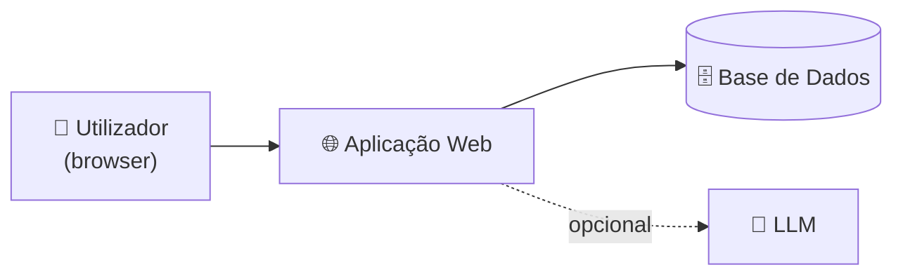

# 📄 Documento de Visão — ESI-KDHEALTH

> **Disciplina:** Engenharia de Software I · Instituto Piaget
> **Projeto:** Loja online de equipamento de apoio à mobilidade

---

## (a) 🎯 Objetivo

Desenvolver uma **loja online especializada em equipamento para pessoas com mobilidade reduzida**: uma aplicação web que permite encomendar, a partir de casa, equipamentos de apoio à mobilidade (como cadeiras de rodas, andarilhos e bengalas), bem como produtos de saúde e medicamentos sem receita.

O sistema pretende que estas pessoas consigam escolher e receber o que precisam de forma simples, sem se deslocarem a uma loja.

---

## (b) 🌍 Escopo

O sistema destina-se ao setor da **saúde e do apoio à mobilidade**, podendo ser usado por:

- lojas farmacêuticas (farmácias);
- ortopedias e lojas de equipamento médico;
- lojas de produtos de saúde e bem-estar com venda online.

---

## (c) 👥 Partes interessadas (stakeholders)

| Quem | Como beneficia |
|---|---|
| **Pessoas com mobilidade reduzida** | Podem encomendar o equipamento e os produtos de que necessitam de forma mais fácil, sem se deslocarem |
| **Pessoas idosas** | Podem encomendar o equipamento e os produtos de que necessitam de forma mais fácil |
| **Familiares e cuidadores** | Conseguem encomendar em nome de quem apoiam, com informação clara sobre cada produto |
| **Lojas (farmácias, ortopedias e lojas de equipamento médico)** | Passam a ter um canal de venda online |

---

## (d) 🧑‍💻 Equipa do projeto

| Nome | GitHub |
|---|---|
| Diogo Marques | [@Mareques](https://github.com/Mareques) |
| Kevin Rosa | [@kappa-30](https://github.com/kappa-30) |

---

## (e) ⚙️ Características do sistema

**Característica principal:** interface de fácil interpretação, que facilita a experiência do utilizador.

**Lista de funcionalidades:**

| # | Funcionalidade | Como ajuda | Estado |
|---|---|---|---|
| 1 | Registo e login simples | Poucos campos e mensagens de erro claras | Planeado |
| 2 | Catálogo por categorias (equipamento de mobilidade, medicamentos sem receita, higiene) | Encontrar o que precisam sem ter de pesquisar | Planeado |
| 3 | Pesquisa que tolera erros de escrita | Quem escreve devagar ou com dificuldade ainda encontra o produto | Planeado |
| 4 | Carrinho e compra em poucos passos | Menos ecrãs, menos hipóteses de desistir ou errar | Planeado |
| 5 | Entrega ao domicílio com morada guardada | Não precisam de sair de casa | Planeado |
| 6 | Botões para aumentar e diminuir o tamanho da letra | Ajuda quem tem problemas de visão | Planeado |
| 7 | Interface simplificada: botões grandes, texto claro, uma ação por ecrã | Ajuda quem tem dificuldade com tecnologia ou tremor nas mãos | Planeado |
| 8 | Área de administração: gerir produtos, stock e estado das encomendas | A loja precisa disto para funcionar | Planeado |
| 9 | Página de detalhe de cada produto (descrição, imagens, medidas, preço e disponibilidade) | Permite escolher o equipamento certo antes de comprar | Planeado |
| 10 | Histórico e estado das encomendas | O cliente acompanha a entrega sem ter de ligar para a loja | Planeado |
| 11 | Contacto com a loja para esclarecer dúvidas | Ajuda a escolher o equipamento adequado | Planeado |
| 12 | Modo de alto contraste | Melhora a leitura para quem tem visão reduzida | Planeado |

---

## (f) 🏗️ Arquitetura de referência

Esquema **provisório** (as tecnologias ainda estão por definir):

| Componente | Função |
|---|---|
| Utilizador (browser) | Interface com o cliente e com o administrador da loja |
| Aplicação Web | Lógica do sistema: contas, catálogo, carrinho e encomendas |
| Base de Dados | Guarda utilizadores, produtos, stock e encomendas |
| LLM (opcional) | Assistente de apoio ao cliente (ver secção h) |

---

## (g) ⚠️ Restrições do produto

Situações que levam o sistema a não funcionar corretamente:

- **Falhas técnicas a nível de código**, por ser a primeira vez que a equipa trabalha com o GitHub.
- Sem ligação à internet (ou ao servidor), o utilizador não consegue aceder ao website.
- Se a base de dados estiver indisponível, não é possível consultar produtos nem registar encomendas.
- Se o stock não for atualizado, podem ser aceites encomendas de produtos que já não existem.
- Se a informação dos produtos (descrição, medidas, preço) estiver incorreta ou incompleta, o cliente pode escolher equipamento inadequado.
- Nesta versão só são contemplados medicamentos sem receita médica.
- A funcionalidade com LLM depende de o Ollama estar instalado e em execução.

---

## (h) 🤖 Integração LLM *(opcional)*

**Proposta, a confirmar pela equipa:** um assistente de apoio ao cliente, executado localmente com o Ollama, que ajuda o utilizador a encontrar o equipamento adequado. O utilizador descreve a sua necessidade em linguagem natural (por exemplo, "preciso de ajuda para me levantar da cama") e o assistente sugere categorias ou produtos do catálogo.

O assistente apenas sugere produtos do catálogo e não dá aconselhamento médico. Será implementado só depois de concluídas as funcionalidades essenciais.
