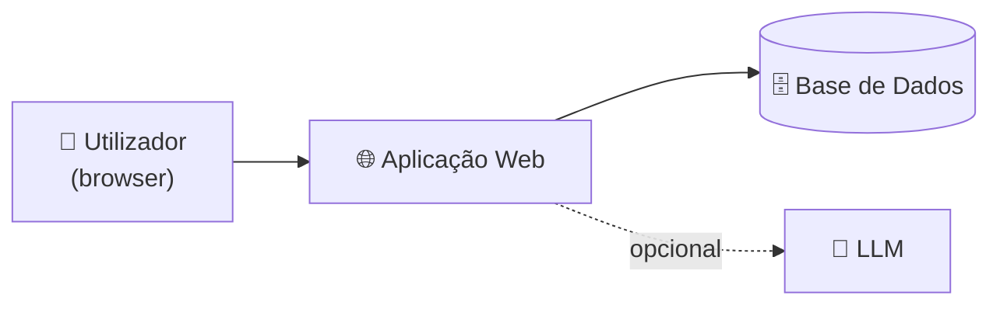

# 📄 Documento de Visão — ESI-KDHEALTH

> **Disciplina:** Engenharia de Software I · Instituto Piaget
> **Projeto:** Farmácia virtual

---

## (a) 🎯 Objetivo

Desenvolver uma **farmácia virtual**: uma aplicação web que permite encomendar medicamentos e produtos de saúde online.

---

## (b) 🌍 Escopo

Lojas farmacêuticas.

---

## (c) 👥 Partes interessadas (stakeholders)

| Quem | Como beneficia |
|---|---|
| **Pessoas com mobilidade reduzida** | Podem encomendar os medicamentos de que necessitam de forma mais fácil, sem se deslocarem |
| **Pessoas idosas** | Podem encomendar os medicamentos de que necessitam de forma mais fácil |
| **Lojas farmacêuticas** | Passam a ter um canal de venda online |

---

## (d) 🧑‍💻 Equipa do projeto

| Nome | GitHub |
|---|---|
| Diogo Marques | [@Mareques](https://github.com/Mareques) |
| Kevin Rosa | [@kappa-30](https://github.com/kappa-30) |

---

## (e) ⚙️ Características do sistema

**Característica principal:** interface de fácil interpretação, que facilita a experiência do utilizador.

**Lista de funcionalidades:**

| # | Funcionalidade | Estado |
|---|---|---|
| 1 | *(a preencher pela equipa)* | A definir |
| 2 | *(a preencher pela equipa)* | A definir |
| 3 | *(a preencher pela equipa)* | A definir |

---

## (f) 🏗️ Arquitetura de referência

Esquema **provisório** (as tecnologias ainda estão por definir):

---

## (g) ⚠️ Restrições do produto

- **Falhas técnicas a nível de código**, por ser a primeira vez que a equipa trabalha com o GitHub.

---

## (h) 🤖 Integração LLM *(opcional)*

A definir pela equipa.
